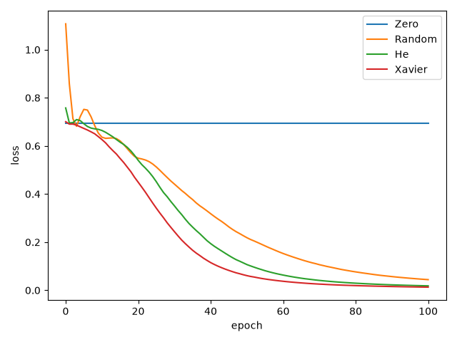
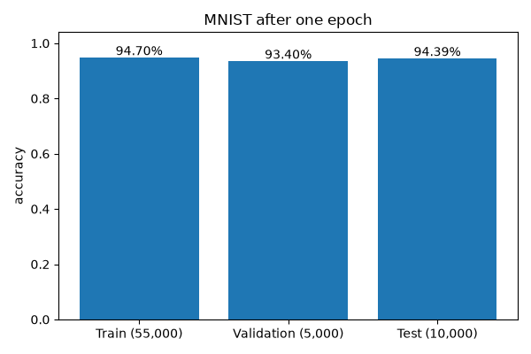
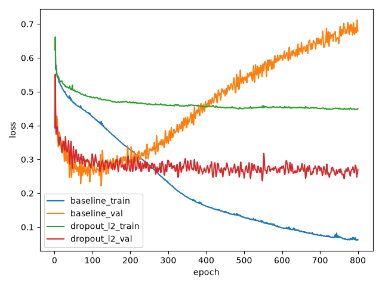

# 나만의 딥러닝 엔진 만들기

NumPy Tensor와 자동 미분, 레이어와 옵티마이저를 구현합니다. 수치 기울기 검사, XOR/MNIST 학습, 초기화 비교와 Dropout/Weight Decay 및 추가 활성화 함수 실험을 수행합니다.

## 실행 환경

Python3.12.14, NumPy2.5.4, Matplotlib3.11.2를 미션 전용 venv에서 사용했습니다. CPU에서 실행했으며 자동 미분/레이어/최적화/배치는 NumPy와 표준 라이브러리로 구현했습니다.

## 진행 상태

Tensor/AutoGrad의 수치 검증, 초기화별 XOR와 MNIST 학습을 수행했습니다. Dropout/L2 실험을 함께 분석합니다.

## 엔진 구조

Tensor는 데이터/기울기/생성 연산과 부모를 보관하고, AutoGrad는 위상 순서 역방향으로 연쇄 법칙을 적용합니다. 브로드캐스팅은 원래 shape으로 합산하며 같은 노드로 이어지는 여러 경로의 기울기를 누적합니다. backward는 현재 그래프의 기울기를 초기화하므로 반복 호출이 이전 결과를 중복 누적하지 않습니다. 행렬곱은2차원만 지원하며 그 밖의 입력은 명시적으로 거절합니다.

```text
$ python gradient_check.py
add_broadcast[0] max_abs=4.458e-13 rel=1.803e-12
add_broadcast[1] max_abs=5.979e-13 rel=1.532e-12
mul_div_pow[0] max_abs=7.837e-13 rel=2.040e-10
mul_div_pow[1] max_abs=2.140e-12 rel=4.448e-10
matmul_both[0] max_abs=1.740e-13 rel=2.724e-12
matmul_both[1] max_abs=1.655e-13 rel=1.374e-12
reductions_reshape[0] max_abs=2.184e-12 rel=3.276e-12
exp_log[0] max_abs=1.092e-12 rel=3.276e-12
linear_layer[0] max_abs=2.243e-13 rel=5.037e-12
linear_layer[1] max_abs=2.377e-13 rel=5.912e-12
linear_layer[2] max_abs=2.080e-13 rel=5.601e-13
relu[0] max_abs=3.098e-13 rel=1.092e-12
sigmoid[0] max_abs=2.038e-12 rel=1.555e-11
tanh[0] max_abs=1.110e-11 rel=5.749e-11
leaky_relu[0] max_abs=3.098e-13 rel=1.092e-12
elu[0] max_abs=3.098e-13 rel=1.092e-12
softmax_weighted[0] max_abs=6.260e-12 rel=1.068e-11
shared_graph[0] max_abs=6.885e-12 rel=6.243e-12
bce_logits[0] max_abs=3.347e-12 rel=9.373e-12
categorical_ce[0] max_abs=1.334e-11 rel=2.737e-11
dropout_fixed_seed[0] max_abs=8.192e-13 rel=3.627e-12
```

중심차분 epsilon=1e-5로 실제 레이어/연산의21개 미분 성분을 비교했습니다. 각 입력에서 노름 상대 오차가1e-7 미만인지 검사합니다. ReLU의미분 불가능한0 부근은 검산 입력에서 피하고 Dropout은 같은 seed의마스크로 비교했습니다.

## 독립 단위 검사

```text
$ python -m unittest discover -s tests -v
add_broadcast[0] max_abs=4.458e-13 rel=1.803e-12
add_broadcast[1] max_abs=5.979e-13 rel=1.532e-12
mul_div_pow[0] max_abs=7.837e-13 rel=2.040e-10
mul_div_pow[1] max_abs=2.140e-12 rel=4.448e-10
matmul_both[0] max_abs=1.740e-13 rel=2.724e-12
matmul_both[1] max_abs=1.655e-13 rel=1.374e-12
reductions_reshape[0] max_abs=2.184e-12 rel=3.276e-12
exp_log[0] max_abs=1.092e-12 rel=3.276e-12
linear_layer[0] max_abs=2.243e-13 rel=5.037e-12
linear_layer[1] max_abs=2.377e-13 rel=5.912e-12
linear_layer[2] max_abs=2.080e-13 rel=5.601e-13
relu[0] max_abs=3.098e-13 rel=1.092e-12
sigmoid[0] max_abs=2.038e-12 rel=1.555e-11
tanh[0] max_abs=1.110e-11 rel=5.749e-11
leaky_relu[0] max_abs=3.098e-13 rel=1.092e-12
elu[0] max_abs=3.098e-13 rel=1.092e-12
softmax_weighted[0] max_abs=6.260e-12 rel=1.068e-11
shared_graph[0] max_abs=6.885e-12 rel=6.243e-12
bce_logits[0] max_abs=3.347e-12 rel=9.373e-12
categorical_ce[0] max_abs=1.334e-11 rel=2.737e-11
dropout_fixed_seed[0] max_abs=8.192e-13 rel=3.627e-12
test_adam_first_two_steps (test_engine.TestEngine.test_adam_first_two_steps)
정의한 수학적 값과 경계 조건을 확인한다. ... ok
test_add_broadcast_grad (test_engine.TestEngine.test_add_broadcast_grad)
정의한 수학적 값과 경계 조건을 확인한다. ... ok
test_backward_reset_semantics (test_engine.TestEngine.test_backward_reset_semantics)
정의한 수학적 값과 경계 조건을 확인한다. ... ok
test_bad_backward_seed_shape (test_engine.TestEngine.test_bad_backward_seed_shape)
정의한 수학적 값과 경계 조건을 확인한다. ... ok
test_bce_logits_extreme (test_engine.TestEngine.test_bce_logits_extreme)
정의한 수학적 값과 경계 조건을 확인한다. ... ok
test_deep_graph_without_recursion (test_engine.TestEngine.test_deep_graph_without_recursion)
긴 그래프도 재귀 제한에 걸리지 않고 미분한다. ... ok
test_dropout_mean_scaling_and_eval (test_engine.TestEngine.test_dropout_mean_scaling_and_eval)
정의한 수학적 값과 경계 조건을 확인한다. ... ok
test_elu_extreme_positive_is_not_exponentiated (test_engine.TestEngine.test_elu_extreme_positive_is_not_exponentiated)
ELU 양수 분기에서 지수 overflow가 발생하지 않는다. ... ok
test_exp_overflow_raises (test_engine.TestEngine.test_exp_overflow_raises)
정의한 수학적 값과 경계 조건을 확인한다. ... ok
test_gradient_checker_runs (test_engine.TestEngine.test_gradient_checker_runs)
정의한 수학적 값과 경계 조건을 확인한다. ... ok
test_initializers_variance (test_engine.TestEngine.test_initializers_variance)
정의한 수학적 값과 경계 조건을 확인한다. ... ok
test_leakyrelu_elu_grads (test_engine.TestEngine.test_leakyrelu_elu_grads)
정의한 수학적 값과 경계 조건을 확인한다. ... ok
test_linear_input_weight_bias_grads (test_engine.TestEngine.test_linear_input_weight_bias_grads)
정의한 수학적 값과 경계 조건을 확인한다. ... ok
test_log_nonpositive_raises (test_engine.TestEngine.test_log_nonpositive_raises)
정의한 수학적 값과 경계 조건을 확인한다. ... ok
test_log_tiny_positive_exact (test_engine.TestEngine.test_log_tiny_positive_exact)
정의한 수학적 값과 경계 조건을 확인한다. ... ok
test_matmul_explicit_grad (test_engine.TestEngine.test_matmul_explicit_grad)
정의한 수학적 값과 경계 조건을 확인한다. ... ok
test_nonfinite_seed_rejected (test_engine.TestEngine.test_nonfinite_seed_rejected)
비유한 seed를 계산에 전파하지 않는다. ... ok
test_power_zero_gradient (test_engine.TestEngine.test_power_zero_gradient)
정의한 수학적 값과 경계 조건을 확인한다. ... ok
test_relu_sigmoid_tanh_values (test_engine.TestEngine.test_relu_sigmoid_tanh_values)
정의한 수학적 값과 경계 조건을 확인한다. ... ok
test_sequential_train_eval (test_engine.TestEngine.test_sequential_train_eval)
정의한 수학적 값과 경계 조건을 확인한다. ... ok
test_sgd_coupled_l2 (test_engine.TestEngine.test_sgd_coupled_l2)
정의한 수학적 값과 경계 조건을 확인한다. ... ok
test_shared_graph_grad (test_engine.TestEngine.test_shared_graph_grad)
정의한 수학적 값과 경계 조건을 확인한다. ... ok
test_softmax_ce_extreme (test_engine.TestEngine.test_softmax_ce_extreme)
정의한 수학적 값과 경계 조건을 확인한다. ... ok
test_softmax_weighted_grad_formula (test_engine.TestEngine.test_softmax_weighted_grad_formula)
정의한 수학적 값과 경계 조건을 확인한다. ... ok

----------------------------------------------------------------------
Ran 24 tests in 0.217s

OK
```

log의 작은 양수, exp의 범위 초과, 0지수, 극단 로짓의 손실, 공유 그래프, 긴 그래프와 Dropout 평가 모드를 확인했습니다. 아직 학습 성공 결과를 대신하는 검사는 아닙니다.

## 초기화별 XOR 학습

동일한 2-16-1 ReLU 구조, 층별 seed42/43, Adam lr0.05, 전체4개 샘플을 사용해100회 갱신했습니다. Random은 표준정규, He는 표준편차 sqrt(2/fan_in), Xavier는 sqrt(2/(fan_in+fan_out))입니다. Xavier 비교도 함께 수행했습니다.

```bash
python train.py xor --include-xavier
```

| 초기화 | 초기 Loss | 50 Epoch Loss | 100 Epoch Loss | 100 Epoch 정확도 |
|---|---:|---:|---:|---:|
| Zero | 0.693147 | 0.693147 | 0.693147 | 50% |
| Random | 1.107229 | 0.218428 | 0.044118 | 100% |
| He | 0.757640 | 0.106714 | 0.018287 | 100% |
| Xavier | 0.700570 | 0.060729 | 0.012917 | 100% |



Zero는 모든 은닉 가중치가 같고 ReLU의0에서 미분을0으로 정의해 대칭을 깨지 못했습니다. 균형 XOR에서는 출력 bias의 평균 기울기도0이어서50회 후 Loss가 그대로였습니다. He는100회에서 Loss0.018287/정확도100%로 기준을 충족했습니다. 이 작은 문제에서는 Xavier가 더 낮은 Loss를 냈으므로 He가 모든 구조에서 항상 더 낫다고 해석하지 않습니다.

## 직접 데이터 로더

`engine/data.py`는 MNIST 원본 gzip의 MD5, IDX의 big-endian 헤더/개수/28x28 크기/라벨 범위를 확인하고 NumPy 배열로 변환합니다. 픽셀은255로 나누며 배치를 직접 생성합니다. [원본 미러와 체크섬 참고](https://github.com/pytorch/vision/blob/main/torchvision/datasets/mnist.py)는 배포 위치 확인에만 사용했습니다. 엔진/로더에 해당 프레임워크를 import하지 않습니다.

```text
$ python -m unittest discover -s tests -v
Ran 27 tests in 0.072s
OK
```

추가3개 검사는 IDX의 잘못된 헤더/길이/라벨과 정규화, 배치 재현성/누락/마지막 작은 배치를 확인합니다. MNIST 실학습과 정규화 비교 결과는 별도로 기록합니다.

## MNIST 1 Epoch 학습

원본60,000장 중 클래스별500장씩 Validation5,000장을 분리하고 Train55,000장을 한 번 학습했습니다. 공식 Test10,000장은 별도로 평가했습니다. seed42, 784-128-10 ReLU, He 초기화, Adam lr0.001, batch128입니다. 입력은0~1 정규화하며 Tensor 연산과 엔진의 backward로 실제 가중치를 갱신했습니다.

```bash
python train.py mnist --data data/mnist --epochs 1
```

```text
{"epoch": 1, "batch_loss_mean": 0.3635001058614332, "train_loss": 0.19147901476501547, "train_acc": 0.947, "val_loss": 0.2242828233973129, "val_acc": 0.934, "test_loss": 0.19602623969889363, "test_acc": 0.9439}
```



Test정확도94.39%로1 Epoch80% 기준을 넘었습니다. Validation93.40%/Test94.39%는 서로 다른 분할에서의 측정이며 Validation과 Test를 학습 입력으로 쓰지 않았습니다. 한 번의 학습이므로 Epoch별 추세나 최적 Epoch를 판단하는 자료로 해석하지 않습니다. 평가 Loss는 마지막 작은 배치의 표본 수를 반영해 집계합니다.

## Dropout과 L2의 과대적합 억제

두 반달을 NumPy로 만들고 Train120/Validation500/Test500으로 각각 분리했습니다. 표준편차0.12의 위치 노이즈와 Train정답24개(20%)의 반전을 seed42로 고정했습니다. 동일한2-64-64-1 Tanh 구조와 같은 초기 가중치를 사용하고, baseline과 Dropout0.2+L2계수0.001을 Adam lr0.01/batch64로800회 비교했습니다. Test는 마지막에만 평가했습니다.

```bash
python train.py regularization
```

| 측정 | 기본 모델 | Dropout + L2 |
|---|---:|---:|
| 오염 Train정답 정확도 | 98.33% | 81.67% |
| 깨끗한 Train정답 정확도 | 81.67% | 96.67% |
| Validation정확도 | 83.00% | 93.80% |
| Test정확도 | 81.20% | 95.00% |
| Validation Loss | 0.678698 | 0.270957 |
| Test Loss | 0.712082 | 0.258442 |
| 가중치/편향 전체 L2 norm | 49.689 | 9.861 |



기본 모델은 오염 정답에98.33%까지 맞추면서 Validation Loss가0.678698로 증가했습니다. Dropout/L2 모델은 깨끗한 Train정답96.67%, Test95.00%였고 가중치 norm도49.689에서9.861로 감소했습니다. Train과 Validation의 정답 오염 조건이 달라 두 Loss의 단순 차이를 순수한 일반화 격차로 해석하지 않습니다. 이 실험은 두 기법의 결합 효과이며 각각의 독립 효과나 모든 데이터의 개선을 보장하지 않습니다.

Dropout은 학습 시 마스크를1/(1-p)배하고 평가 시 항등 연산으로 바뀝니다. L2는 SGD/Adam의 기울기에 lambda*w를 더하며 여기서는 편향도 포함합니다. AdamW의 분리된 weight decay는 구현하지 않았습니다. Tanh/LeakyReLU/ELU의 역전파는 수치 검사에 포함했고, 실험에서는 Tanh를 사용했습니다.

## 설치와 사용

```bash
python3.12 -m venv .venv
source .venv/bin/activate
python -m pip install -r requirements.txt
python gradient_check.py
python -m unittest discover -s tests -v
python train.py xor --include-xavier
python train.py mnist --data data/mnist
python train.py regularization
```

```python
from engine import Tensor
x = Tensor([[1., 2.]])
w = Tensor([[3.], [4.]])
y = (x @ w).sum()
y.backward()
print(y.data, x.grad, w.grad)
# 11.0, [[3. 4.]], [[1.], [2.]]
```

`engine/tensor.py`가 연산 그래프를 만들고 `engine/autograd.py`가 미분 순서를 관리합니다. `engine/layers.py`는 Tensor를 조합하고 `engine/optim.py`는 파라미터의 grad를 사용해 갱신합니다. `engine/data.py`는 네트워크 다운로드와 직접 파싱/배치를 담당하며 `train.py`가 이 모듈들을 연결합니다. 실행 결과의 원시 수치는 `figures/*_history.csv`와 `*_summary.json`에 있습니다.

기울기는float64이며 GPU, 합성곱, 임의 차원 batched matmul, 자동 no_grad 모드는 지원하지 않습니다. 저장한 출력으로 수치 검증과 학습 성공을 확인했으며 범용 프레임워크의 기능 전체를 구현한 것은 아닙니다.
